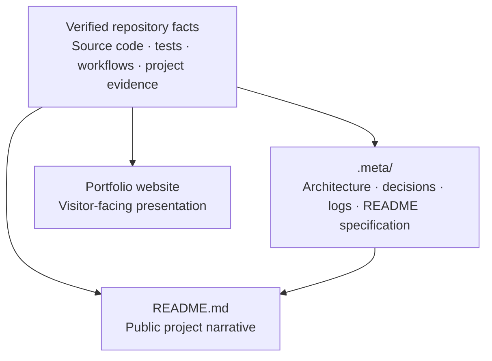

# Documentation Architecture

**Status:** Active documentation policy  
**Last reviewed:** 2026-11-17

## 1. Documentation layers

The root README is a public-facing explanation. The `.meta/` directory is the internal documentation control plane. Source code, tests, and workflow configuration remain the evidence for implementation claims.

## 2. Source-of-truth hierarchy

When descriptions conflict, use this order:

1. Current source code and configuration for implemented behavior.
2. Automated tests and recorded validation results for verified behavior.
3. Architecture and decision records for intended structure and rationale.
4. Root README and portfolio copy for concise public communication.
5. Roadmap statements for future intent only.

A README statement must never override contradictory implementation evidence.

## 3. README information architecture

The root README should be organized as a deliberate narrative:

1. **Identity and positioning** — who the portfolio represents and its focus.
2. **Quick navigation** — concise access to major sections.
3. **About** — profile, contribution, and transparent AI-assisted workflow.
4. **Engineering approach** — principles and method.
5. **Workflow** — the path from discovery to validation.
6. **Selected work** — case studies with purpose, current implementation, contribution, limitations, and stack.
7. **Architecture maps** — current state separated from target state.
8. **Engineering decisions** — selected trade-offs and reasoning.
9. **Technical interests** — areas of exploration.
10. **Education and achievements** — evidence-backed background.
11. **Contact** — reliable communication channels.

Sections may evolve, but the README should remain scannable and avoid repeating the same facts in multiple places.

## 4. Case-study contract

Every substantial project entry should answer:

- What problem or product direction does it explore?
- What exists in the current implementation?
- What was the portfolio owner's contribution?
- Which technologies are present in the repository?
- What is incomplete or explicitly out of scope?
- Which capabilities are future plans rather than current features?

Avoid inflated labels such as "production-ready", "fully autonomous", or "complete IDE" unless supported by evidence.

## 5. Update protocol

When a feature changes:

1. Inspect the relevant source and configuration.
2. Update the current-state architecture if system boundaries or flows changed.
3. Add a decision record when a durable architectural trade-off was made.
4. Append a development-log entry with the change and actual validation performed.
5. Update the root README only when public-facing facts or structure changed.
6. Check that README claims still match source and current status.

Do not create a README generator until there is a clear need. For now, keep the relationship explicit and reviewable rather than introducing a fragile build dependency.

## 6. Writing and evidence conventions

- Use **Current**, **Planned**, **Experimental**, and **Not verified** consistently.
- Include dates in ISO format: `YYYY-MM-DD`.
- Use repository-relative links.
- Prefer concise diagrams that explain boundaries over decorative diagrams.
- Record only meaningful events in the development log; do not log every trivial edit.
- Never include secrets, access tokens, private data, or credentials.
