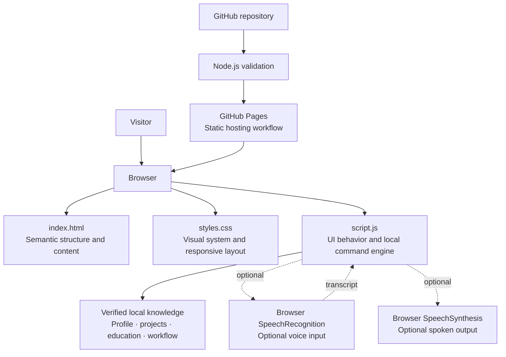
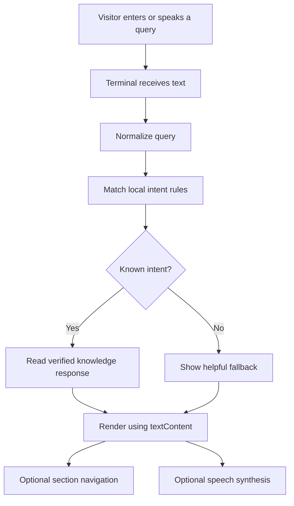
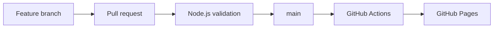

# System Architecture

**Status:** Current-state baseline  
**Last reviewed:** 2026-11-17  
**Scope:** `About-me-Portfolio`

## 1. System purpose

A static, responsive personal portfolio with an interactive local command interface. It presents a profile, selected projects, working approach, learning journey, and contact channels.

The site is intentionally lightweight: no application server or external AI service is required for its current core experience.

## 2. High-level architecture

## 3. Runtime components

| Component | Responsibility | Current boundary |
|---|---|---|
| `index.html` | Page structure, metadata, accessible controls, portfolio content | Static HTML |
| `styles.css` | Design tokens, layout, responsive behavior, motion preferences, terminal styling | Static CSS |
| `script.js` | Navigation, reveal effects, command routing, history, optional voice APIs | Browser-side JavaScript |
| Local knowledge base | Verified answers about the portfolio owner and projects | Rule-based data and intent matching; not an LLM |
| Speech recognition | Converts microphone speech to text when browser support and permission exist | Optional browser API |
| Speech synthesis | Reads responses when supported and enabled | Optional browser API |
| `scripts/validate.mjs` | Checks required files, metadata, IDs, fragment links, local assets, terminal hooks, and key destinations | Dependency-free Node.js static validation |
| `package.json` | Exposes `npm run check` and `npm run validate` | No runtime dependencies |
| GitHub Actions | Runs validation on pull requests and before publishing | Job-scoped permissions; branch/ref-scoped concurrency |
| GitHub Pages | Serves the built static files | Hosting target; deployment must be verified independently |

## 4. Command interaction flow

The command engine is deliberately local and deterministic. It must not claim to be connected to an AI model unless a real backend integration is implemented and verified.

## 5. Repository and delivery flow

The current portfolio work is maintained on `feat/premium-portfolio-foundation` and reviewed through PR #1. Pull requests run static validation; deployment is skipped for pull-request events. A pull request being open does not mean the changes are merged or deployed.

## 6. Security and quality boundaries

- User-entered command text is treated as input, not trusted markup.
- Terminal responses are rendered with `textContent`, not interpolated as HTML.
- No API keys or credentials belong in client-side source or this repository's documentation.
- The validation job receives only `contents: read`; Pages publishing permissions are scoped to the jobs that need them.
- Workflow concurrency is scoped by workflow and Git ref so pull-request validation cannot cancel a main-branch deployment.
- Microphone access is optional and depends on browser support, permission, and secure-context requirements.
- Voice output is opt-in and should remain disabled by default.
- Reduced-motion preferences must be respected.
- Project descriptions must distinguish current implementation from roadmap items.
- Static validation is a fast integrity check, not a browser, accessibility, or end-to-end test.

## 7. Explicit non-goals of the current system

The current site is not:
- a server-backed AI assistant;
- a user-account or data-storage platform;
- a live analytics dashboard;
- a full CMS;
- a backend application;
- proof that every project feature or deployment has passed production validation.

## 8. Change triggers

Update this document when:
- a real API/backend is added;
- the command engine changes from local rules to model-backed orchestration;
- persistence or user accounts are introduced;
- hosting/build architecture changes;
- a new runtime integration materially changes the security boundary;
- the validation suite or CI delivery gates materially change.

## 9. GitHub Pages prerequisite

The repository must have GitHub Pages enabled with the publishing source set to **GitHub Actions** before the main-branch deployment job can configure and publish the site. Pull requests run static validation only; they do not attempt to configure Pages or deploy. A successful validation run is not evidence of a successful Pages deployment.
