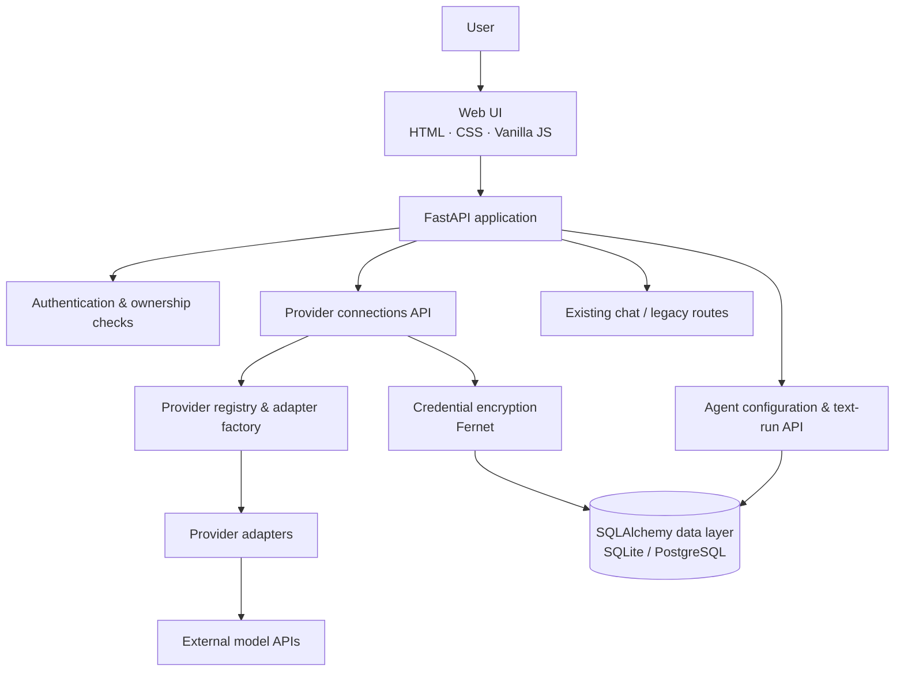
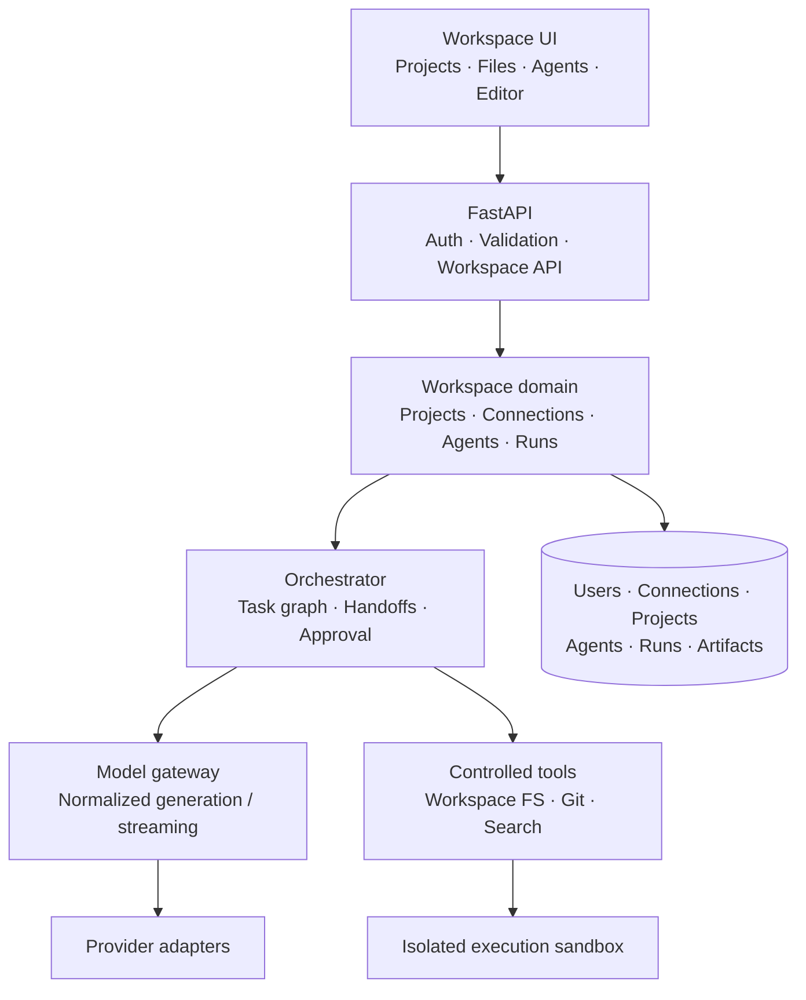
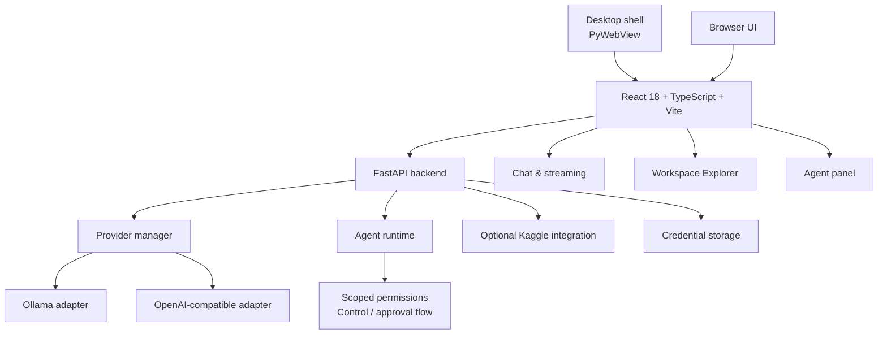

<!--
  DILSHODBEK QOSIMOV | PORTFOLIO
  One-file portfolio. Verified scope over inflated claims.
-->

  
   
  <strong>Turning ambitious product ideas into structured, testable software.</strong>
    
  
  
    
  UZBEKISTAN · UTC+5 &nbsp; / &nbsp; UZBEK — NATIVE &nbsp; / &nbsp; ENGLISH — B1, WORKING TOWARD B2

---

[ABOUT](#about) &nbsp;·&nbsp; [APPROACH](#engineering-approach) &nbsp;·&nbsp; [WORKFLOW](#workflow) &nbsp;·&nbsp; [CASE STUDIES](#selected-work) &nbsp;·&nbsp; [EDUCATION](#education) &nbsp;·&nbsp; [CONTACT](#contact)

---

## 01 / About

I am an aspiring product-focused developer interested in application architecture, AI-assisted engineering, and building software products from the ground up.

My strongest contribution is in **structuring and coordinating development**: translating product ideas into architecture maps, decomposing complex work into manageable tasks, coordinating AI tools, tracking dependencies, and validating the resulting experience.

I think in systems: how modules communicate, how data moves, where failure can happen, and whether the product makes sense from the user's point of view.

<blockquote>
  <strong>Transparency matters.</strong> 
  My personal projects are developed with substantial AI assistance. I use AI tools as implementation collaborators while focusing on planning, orchestration, review, and product-level validation. Technologies shown below describe each project's implementation environment — they are not a claim of professional, independent proficiency in every listed language or framework.
</blockquote>

| PROFILE | DETAILS |
|:--|:--|
| Location | Uzbekistan · UTC+5 |
| Focus | Product architecture · AI-assisted development · Technical orchestration · Exploratory QA |
| Languages | Uzbek — Native · English — approximately B1, progressing toward B2 |
| Email | [shakha1210@gmail.com](mailto:shakha1210@gmail.com) |
| GitHub | [@shakha1210-pixel](https://github.com/shakha1210-pixel) |

## 02 / Engineering approach

<table>
  <tr>
    <td width="50%" valign="top">
      <strong>01 — Architecture before implementation</strong> 
      Clarify the product goal, map modules and interfaces, and identify dependencies before execution begins.
    </td>
    <td width="50%" valign="top">
      <strong>02 — Decompose complexity</strong> 
      Convert large goals into small, ordered tasks with clear outcomes and checkpoints.
    </td>
  </tr>
  <tr>
    <td width="50%" valign="top">
      <strong>03 — Coordinate AI agents</strong> 
      Use focused agents for implementation, review, and debugging; compare results rather than blindly trusting one output.
    </td>
    <td width="50%" valign="top">
      <strong>04 — Validate real behavior</strong> 
      Run available tests, inspect dependencies, and manually explore user journeys to find issues.
    </td>
  </tr>
  <tr>
    <td width="50%" valign="top">
      <strong>05 — Keep work traceable</strong> 
      Maintain task plans, commit-level steps, terminal instructions, and practical technical notes.
    </td>
    <td width="50%" valign="top">
      <strong>06 — Be explicit about status</strong> 
      Separate implemented features from experiments, limitations, and future plans.
    </td>
  </tr>
</table>

## 03 / Workflow

  FROM PRODUCT IDEA TO VERIFIED ITERATION
    
  <strong>DISCOVER</strong> &nbsp;→&nbsp; <strong>ARCHITECT</strong> &nbsp;→&nbsp; <strong>DECOMPOSE</strong>
   
  ↓
   
  <strong>COORDINATE</strong> &nbsp;→&nbsp; <strong>IMPLEMENT</strong> &nbsp;→&nbsp; <strong>TEST</strong>
   
  ↓
   
  <strong>EXPLORE</strong> &nbsp;→&nbsp; <strong>DOCUMENT</strong> &nbsp;→&nbsp; <strong>REFINE</strong>

| Stage | Working method |
|:--|:--|
| Discovery | Define the user problem, product scope, and expected outcome. |
| Architecture | Map modules, interfaces, data flow, and dependencies. |
| Decomposition | Break the roadmap into ordered, verifiable tasks. |
| Coordination | Give AI agents focused responsibilities and review their outputs. |
| Implementation | Track changes, commands, commits, and integration points. |
| Validation | Run available automated checks and investigate failures. |
| Exploratory QA | Use the application directly and test realistic user flows. |
| Documentation | Record setup, decisions, dependencies, limitations, and next steps. |

---

## 04 / Selected work

The projects below are independent experiments and products. Each case study distinguishes the current implementation from the intended direction.

### 01 — APEIRON / AI WORKSPACE

**A configurable AI workspace for connecting model providers and building personal agents.**

Apeiron explores the transition from a conventional chat application toward a workspace where provider connections, configurable agents, projects, and future orchestration capabilities can live together.

**Product problem**

AI workflows often become fragmented across providers, chats, credentials, and separate tools. Apeiron explores a unified environment in which users can manage their model connections and configure agents around their own workflows.

**Current implementation**

- FastAPI backend with SQLAlchemy, Pydantic, and HTTPX.
- HTML, CSS, and Vanilla JavaScript frontend.
- SQLite by default, with PostgreSQL support through SQLAlchemy.
- Provider registry and adapter foundation, including native provider integrations and OpenAI-compatible endpoints.
- API connection management with server-side encrypted credential storage.
- Agent Builder API and settings UI for creating and managing agent configurations.
- One-turn text generation through a configured agent and provider.
- Pytest-based test setup.

**Architecture at a glance**

~~~text
APEIRON
├── Frontend
│   ├── Existing chat experience
│   └── Settings / provider connections / Agent Builder
│
└── Backend — FastAPI
    ├── Provider registry and adapters
    ├── Connection and credential management
    ├── Agent configuration and run endpoint
    ├── SQLAlchemy data layer
    └── API routes and validation
~~~

**My focus in the project**

- Structuring the product direction and workspace architecture.
- Breaking the migration into incremental implementation tasks.
- Coordinating AI-assisted implementation and review.
- Tracking provider, agent, and workspace dependencies.
- Reviewing the product flow and documenting incomplete areas.

**Known limitations**

- The migration to a complete workspace experience is not finished.
- The current agent run endpoint generates text; it does not execute tools.
- A full sandbox and human approval runtime for agent actions is not yet available.
- Registered provider IDs should not be confused with a fully finished, universally compatible provider ecosystem.
- Planned orchestration capabilities remain future work until implemented and verified.

  
<strong>Product direction / next milestones</strong>

  - Complete the workspace experience around projects, files, agents, and tasks.
  - Expand and verify provider compatibility and model discovery.
  - Develop safe tool execution with explicit permissions, isolation, and approvals.
  - Add observable multi-step agent runs and orchestration.
  - Continue strengthening authentication, ownership checks, and outbound endpoint security.

  These are roadmap items, not claims about the current release.

**Environment:** Python · FastAPI · SQLAlchemy · Pydantic · HTTPX · SQLite / PostgreSQL · Vanilla JavaScript

---

### 02 — NEXUS / AI TERMINAL FOR OLLAMA

**A local-first AI workspace that brings conversations, model connections, agents, and workspace tools into one desktop-oriented environment.**

NEXUS is designed around user choice: connect local models or compatible remote services, then work with them through a consistent interface.

**Product problem**

Local AI tools, remote model APIs, conversations, and project files can feel disconnected. NEXUS aims to make these capabilities accessible through one workspace while keeping local inference and user-controlled configuration central.

**Current implementation**

- FastAPI backend.
- React 18, TypeScript, and Vite frontend.
- PyWebView desktop launcher and Windows packaging workflow.
- Provider abstraction with Ollama and an OpenAI-compatible API adapter.
- Streaming chat and conversation history.
- Shared provider/model selection across chat and agent flows.
- Workspace Explorer with scoped file and directory operations.
- Initial agent runtime with workspace read permissions, control modes, isolation controls, and approval flow for supported file-edit proposals.
- Optional Kaggle notebook/runtime integration, requiring the user's own configuration.
- Credential-storage foundation using the operating system keyring where supported.
- Backend and frontend CI/build workflows.

**Architecture at a glance**

~~~text
NEXUS
├── Desktop shell
│   └── PyWebView / Windows packaging
├── Frontend — React + TypeScript
│   ├── Chat and history
│   ├── Provider / model controls
│   ├── Agent panel
│   ├── Workspace Explorer
│   └── Settings and diagnostics
└── Backend — FastAPI
    ├── Provider adapters
    │   ├── Ollama
    │   └── OpenAI-compatible API
    ├── Chat and streaming
    ├── Agent runtime / tools / permissions
    ├── Workspace services
    ├── Secrets and preferences
    └── Optional Kaggle integration
~~~

**My focus in the project**

- Planning the product structure and modular architecture.
- Decomposing features into implementation stages.
- Coordinating AI-assisted work across frontend and backend concerns.
- Reviewing integration boundaries between providers, agents, and workspace tools.
- Following build/test feedback and exploring the application manually.
- Maintaining technical notes, commands, and known limitations.

**Known limitations**

- The provider catalogue is not yet a fully dynamic, user-extensible connection manager.
- NEXUS is not yet a full IDE: a complete editor, integrated terminal, language servers, debugger, and mature Git UI are not established features.
- The plugin SDK, loader, and full plugin lifecycle are not complete.
- Agent behavior is limited by the current tool and permission model; it is not an unrestricted autonomous coding agent.
- Backend authentication and deployment hardening need further work before exposure to untrusted networks.
- Windows desktop packaging still needs validation on real supported machines.

  
<strong>Product direction / next milestones</strong>

  - Refine the premium, chat-first interface and navigation.
  - Expand provider connection management.
  - Improve the workspace editing experience and terminal direction.
  - Strengthen agent tool contracts, context handling, and permission boundaries.
  - Design a documented and secure plugin lifecycle.
  - Improve backend authentication and desktop release validation.

  PostgreSQL/pgvector, Redis, object storage, workers, billing, RBAC, RAG, and broader integrations are architectural possibilities on the roadmap — not current runtime capabilities.

**Environment:** Python · FastAPI · React 18 · TypeScript · Vite · PyWebView · Ollama

---

### 03 — LOGIC-HUB

**A modular JavaScript project focused on separating core logic into dedicated components.**

The repository is organized around distinct engines and a test-oriented structure.

**Visible module structure**

- Achievement Engine
- Challenge Engine
- Event Engine
- Logic-Hub Core
- Ranking Engine

**My focus in the project**

Exploring modular organization, separating responsibilities, and keeping the core logic easier to reason about and validate.

**Environment:** JavaScript

---

### Project relationship

Apeiron and NEXUS are **separate, independent projects today**. A future unified direction is an idea under consideration; no completed merger or shared production architecture is claimed.

---

## 05 / Architecture maps

These diagrams are intentionally split into **current implementation** and **future direction**. They describe verified repository boundaries at a high level, not every internal class or deployment detail.

### Apeiron — current implementation

Current-state view: the provider and agent APIs are implemented as a separate workspace foundation. They are not yet a complete replacement for all legacy chat routing.

### Apeiron — intended evolution

Target-state concept only. Orchestration, task graph, isolated execution, and the complete workspace interface are not represented as finished features.

### NEXUS — current application structure

High-level map of the documented current foundation. It is a modular application, not a claim that each box is a separately deployed service.

### How to read the diagrams

| Visual convention | Meaning |
|:--|:--|
| Solid path in current-state maps | Documented application component or integration |
| Target-state map | Planned architectural direction |
| External provider | User-configured model/API service |
| Isolated sandbox | Required future security boundary for executing untrusted code |

## 06 / Engineering decisions

A portfolio should show not only *what* exists, but also *why* the system is shaped this way.

### Apeiron

| Decision | Reasoning |
|:--|:--|
| Provider adapter boundary | Keep vendor-specific request/response behavior behind a normalized interface. |
| Server-side encrypted credentials | Avoid exposing raw provider keys to browser storage or API responses. |
| Owner-scoped resources | Prevent one user's connections or agents from being accessed by another user. |
| Deny-by-default agent capabilities | Configuration must not silently grant tools that have no safe execution boundary. |
| Incremental migration | Preserve existing chat behavior while the workspace foundation is developed and verified. |

### NEXUS

| Decision | Reasoning |
|:--|:--|
| Local-first model support | Keep Ollama as a first-class option rather than requiring a hosted inference provider. |
| Provider abstraction | Give the interface a consistent way to work with Ollama and compatible remote APIs. |
| Modular monolith | Strengthen clear internal boundaries before introducing distributed services. |
| Scoped workspace access | Keep agent file operations within explicitly permitted workspace boundaries. |
| Progressive complexity | Keep the default chat experience approachable while making advanced workspace capabilities accessible when needed. |

### My role in these projects

My contribution is centered on product direction and development coordination:

- Translating broad product goals into architecture maps and staged roadmaps.
- Breaking implementation into focused tasks with dependencies and checkpoints.
- Coordinating AI-assisted implementation, independent review, and debugging.
- Following integration points across frontend, backend, providers, and workspace modules.
- Reviewing test feedback and manually exploring application behavior.
- Recording implementation status, known limitations, and next milestones.

I do not present AI-generated implementation as proof of independent mastery of every technology. My focus is on making the development process structured, reviewable, and transparent.

---

## 07 / Technical interests

- AI-assisted software development and multi-agent workflows
- Product and application architecture
- Modular systems and dependency design
- API-driven applications
- Local AI runtimes and model-provider integrations
- Testing, debugging workflows, and exploratory QA
- Developer productivity and interactive user experiences

## 06 / Education

**Rakhmonov IT School — Samarkand**  
Frontend Development · 2022

**Certificates**
- Frontend Development
- HTML / CSS

## 07 / Achievements

- Repeated first-place results in district-level IT competitions.
- Participation in regional-level IT competitions.

---

## 08 / Contact

Interested in product development, AI-assisted engineering workflows, and opportunities where structured thinking and careful execution matter.

   
  
    
  <a href="https://github.com/shakha1210-pixel">GitHub Profile</a>
  &nbsp;·&nbsp;
  <a href="https://github.com/shakha1210-pixel/About-me-Portfolio">Portfolio Repository</a>
    
  BUILT WITH INTENTION · DOCUMENTED WITH TRANSPARENCY · ALWAYS ITERATING

---

This README is the single-file portfolio and is maintained as the projects evolve. For implementation details, setup instructions, and the latest verified status, consult the linked project repositories.
